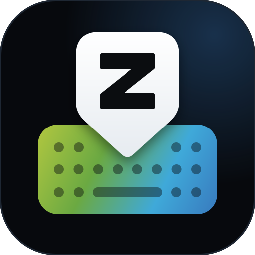

> **Meridian Tastatur:** Dieser Fork von zBoard misst zusätzlich die Tipp-Dynamik (nur Zeiten und Tastenarten,
> nie Zeichen) für die App zHealth Meridian. Alles dazu in [Meridian/README.md](Meridian/README.md).



# zBoard

🇬🇧 [English](README.md) | 🇩🇪 **Deutsch**

[](https://github.com/World-of-Bytes/zBoard/actions/workflows/build.yml)

zBoard ist eine freie Android-Tastatur, die sich in Bedienung und Funktionsumfang an Gboard orientiert:
Wortvorschläge und Autokorrektur mit Satzkontext, Wischeingabe, Nächstes-Wort-Vorhersage, Wortfolgen,
E-Mail-Vorschläge, Emoji, Zwischenablage und Spracheingabe für Deutsch, Englisch, Französisch, Spanisch und Italienisch.
Anders als Gboard arbeitet zBoard vollständig offline und ohne Internetberechtigung; was es aus deinen Eingaben
lernt, bleibt auf dem Gerät. Funktionen, die Internet brauchen (etwa Übersetzen mit DeepL), kommen als eigene
Plugin-Apps dazu – nur wer sie installiert, gibt ihnen Internetzugriff. Geschrieben ist zBoard in C# mit .NET 10 for Android.

Stand: **alle fünf Meilensteine umgesetzt** – Testphase auf echten Geräten, noch nicht veröffentlicht.

## zBoard im Vergleich zu Gboard

| | Gboard | zBoard |
| --- | --- | --- |
| Lizenz | proprietär, Quellcode nicht öffentlich | BSD 2-Clause (Code), Wortlisten und Sprachmodelle CC BY-SA 4.0 |
| Internetzugriff | ja (u. a. GIFs, Übersetzen, Synchronisation) | keine Internetberechtigung; Internet-Funktionen nur über eigene Plugin-Apps |
| Lernen aus Eingaben | ja, Modelle werden per Federated Learning mit Google-Servern verbessert | ja, ausschließlich auf dem Gerät, abschaltbar und löschbar; lange nicht Benutztes verliert an Gewicht |
| Sprachen | sehr viele Sprachen und Layouts | Deutsch (QWERTZ), Englisch, Spanisch, Italienisch (QWERTY), Französisch (AZERTY) |
| Tippen, Umschalt, Symbole, langer Druck für Sonderzeichen | ✓ | ✓ in Gboard-Reihenfolge, häufigstes Zeichen vorausgewählt |
| Wortvorschläge und Autokorrektur | ✓ | ✓ 120 000 deutsche, 100 000 englische Wörter; rechnet mit der Stelle, an der der Finger die Taste traf; Vertauschungen, weggelassene Umlaute und Apostrophe |
| Sprachmodell | neuronales Netz, sieht den ganzen Satz | Zähltabelle häufiger Wortfolgen, sieht die zwei Wörter davor; jeder Wert nachvollziehbar, rund 2,4 MB je Sprache |
| Korrektur nach dem Satz | ✓ | ✓ „ich hae“ → „habe“; richtig geschriebene Wörter nur, wenn der Finger fast auf der Tastengrenze lag („heute drei“ → „frei“) |
| Fehlende und versehentliche Leerzeichen | ✓ | ✓ „ichhabe“ → „ich habe“, „da ke“ → „danke“ |
| Zusammengesetzte deutsche Substantive | ✓ | ✓ aus bekannten Substantiven erkannt, großgeschrieben und vervollständigt („Haustürschlüssel“) |
| Großschreibung deutscher Substantive | ✓ | ✓ mehrdeutige Wörter aus dem Satz („eine frage“ → „Frage“) |
| Mehrsprachige Eingabe (mehrere Wörterbücher gleichzeitig, „DE · EN“ auf der Leertaste) | ✓ | ✓ bis zu drei Sprachen, Sprache des vorherigen Worts bevorzugt |
| Großschreibung am Satzanfang | ✓ | ✓ auch in Apps, die sie nicht anfordern |
| Nächstes-Wort-Vorhersage | ✓ | ✓ aus dem Sprachmodell und eigenen Wortfolgen, auch am Satzanfang und nach Komma |
| Ganze Wortfolgen vorschlagen („freundlichen Grüßen“) | ✓ | ✓ aus Gelerntem |
| Vorschläge für ein angetipptes Wort im Text | ✓ | ✓ Antippen ersetzt das ganze Wort |
| E-Mail-Adressen vorschlagen | ✓ | ✓ gemerkte Adressen und bekannte Anbieter nach „@“ |
| Wischeingabe (Glide Typing) | ✓ | ✓ |
| Cursor per Leertaste, Wort-Löschen per Wischen | ✓ | ✓ |
| Tastenvorschau, Vibration, Ton | ✓ | ✓ |
| Designs | ✓ | hell, dunkel, Material You (Farben aus dem Hintergrundbild) |
| Emoji-Tastatur | ✓ | ✓ mit Kategorien, Hauttönen, „Zuletzt verwendet“ und Suche in allen fünf Sprachen |
| Zwischenablage-Verlauf | ✓ | ✓ eine Stunde, Anheften, vertrauliche Inhalte ausgenommen |
| Sichern & wiederherstellen (Einstellungen, gelernte Wörter, E-Mail-Adressen, angeheftete Zwischenablage) | teilweise: gelernte Wörter nur per Synchronisation mit dem Google-Konto, Export des persönlichen Wörterbuchs; keine Sicherung der Einstellungen | ✓ als ZIP-Datei, die du ablegst, wo du willst – ohne Konto |
| GIFs und Sticker | ✓ | bewusst nicht (bräuchte Internetzugriff) |
| Spracheingabe | ✓ | ✓ über die Spracherkennung des Systems, standardmäßig nur offline |
| Werkzeugleiste (Zwischenablage, Mikrofon, Einstellungen) | ✓ | ✓ über den Pfeil links in der Vorschlagsleiste |
| Einhandmodus, Höhe, Zahlenreihe | ✓ | ✓ |
| Übersetzen | ✓ | ✓ über die Plugin-App „zBoard DeepL“ (eigener DeepL-API-Schlüssel) |
| Synchronisation zwischen Geräten | gelernte Wörter über das Google-Konto | ✓ über die Plugin-App „zBoard Sync“: Einstellungen, gelernte Wörter, E-Mail-Adressen via Google Drive, OneDrive, Dropbox oder WebDAV (HiDrive, Nextcloud …) |
| Google-Dienste | ✓ | nicht geplant |

## Bauen und installieren

Voraussetzungen: .NET 10 SDK, Android-Workload, Android SDK (bringen Visual Studio 2026 oder Rider mit).

```bash
dotnet workload install android
dotnet build -t:Run -f net10.0-android          # baut und installiert auf dem verbundenen Gerät/Emulator
```

Danach die App **zBoard** öffnen, auf der Startseite „Aktivieren“ und „Auswählen“ antippen und unter
„Tastatur ausprobieren“ lostippen. Paketname: `de.World_of_Bytes.zBoard`.

Die Oberfläche ist zweisprachig: Deutsch, wenn das System auf Deutsch steht, sonst Englisch
(`Localization/L.cs`, Texte direkt im Code als `L.T("Deutsch", "English")`).

## Testversion und Veröffentlichung

- Jeder Push auf `main` baut eine Debug- und eine Release-Version (AOT), testet beide im Emulator und veröffentlicht
  die Release-Version mit dem öffentlichen Testschlüssel als
  [Testversion](https://github.com/World-of-Bytes/zBoard/releases/download/testversion/zboard-test.apk).
- **Store-Version:** Auf GitHub ein Release veröffentlichen (Tag `v<Version>`). GitHub Actions baut dann mit dem
  Upload-Schlüssel aus den Repository-Secrets `zboard-<Version>.aab` (für Google Play) und `zboard-<Version>.apk`
  samt DeepL-Plugin und hängt sie an das Release. Einrichtung des Schlüssels: [signing/README.md](signing/README.md).
- Texte, Grafiken und Angaben für den Play-Store-Eintrag: [docs/store](docs/store/listing.md),
  Datenschutzerklärung: [docs/PRIVACY.md](docs/PRIVACY.md).
- Version: `ApplicationDisplayVersion` und `ApplicationVersion` (bei jedem Store-Upload um 1 erhöhen) in `ZBoard.csproj`.

## Tests

Die Logik ohne Android (Wörterbuch, Autokorrektur, Sprachmodell, Fingerpositionen, zusammengesetzte Wörter,
Leerzeichen, Vorhersage, Wortfolgen, Lernen, E-Mail-Adressen, Wischeingabe, Emoji, Zwischenablage, Layouts,
Sonderzeichen-Popup, Sicherungen) hat eigene Unit-Tests:

```bash
dotnet test tests/ZBoard.Core.Tests
```

Der Emulator-Test (`tools/emulator_test.py`, läuft in GitHub Actions) prüft Tippen, Autokorrektur, fehlende und
versehentliche Leerzeichen, Wischeingabe, Popups, Vorschlagsleiste und Lage der Tastatur auf einem echten
Android-System, teils durch Ausmessen von Screenshots.

Wie gut Vorschläge und Autokorrektur sind, misst `tools/SuggestionEval` mit simuliertem Tippen
(Kennzahlen im Einzelnen: [tools/SuggestionEval/README.md](tools/SuggestionEval/README.md), Ergebnisse unter
[Vorschläge und Autokorrektur](#vorschläge-und-autokorrektur)):

```bash
dotnet run -c Release --project tools/SuggestionEval -- --lang de
```

## Aufbau

| Ordner | Inhalt |
| --- | --- |
| `Ime/` | `ZBoardImeService` (Herzstück), `EditorProfile` (Eigenschaften des Eingabefelds), `TextBoundaries` |
| `Keyboard/` | Layout-Modell, alle Layouts, `KeyboardView` (Zeichnen und Touch), `PopupGrid` (Anordnung im Popup), Farben |
| `Emoji/` | `EmojiCatalog` (Daten, Suche, Hauttöne), `EmojiPanelView` |
| `Clipboard/` | `ClipboardHistory`, `ClipboardPanelView` |
| `Suggestions/` | `WordDictionary` (sortiertes Array), `SuggestionEngine`, `GlideDecoder`, `NgramModel` (Sprachmodell), `TouchTrace` (Fingerpositionen), `UserHistory`, `EmailMemory`, `KeyProximity`, `SuggestionBarView` |
| `Settings/` | `SettingsActivity` (Startbildschirm), `ZBoardSettings` |
| `Backup/` | `BackupArchive` (Sicherungsdatei: Schreiben, Lesen, Prüfen) |
| `Assets/dict/` | Wortlisten und Sprachmodelle pro Sprache |
| `Assets/emoji/` | Emoji nach Kategorien, Namen und Suchbegriffe pro Sprache |
| `Plugins/` | `PluginContract` (Schnittstelle), `PluginRegistry` (installierte Plugins), `PluginClient` (Messenger) |
| `plugin-apps/DeepL/` | Plugin-App „zBoard DeepL“ (eigene App mit Internet-Berechtigung) |
| `Sync/` | `SyncManager` (Abgleich über ein Plugin), `SyncFileProvider` (Datei-Übergabe an das Plugin) |
| `plugin-apps/Sync/` | Plugin-App „zBoard Sync“ (Google Drive, OneDrive, Dropbox, WebDAV); Einrichtung der Anbieter in der README dort |
| `tools/` | `build_dictionaries.py` (Wortlisten), `NgramBuilder` (Sprachmodelle), `SuggestionEval` (Vorschlagsmessung), `build_emoji.py` (Emoji-Daten), `emulator_test.py` |
| `tests/` | Unit-Tests der plattformunabhängigen Logik |

## Wörterbücher

Mitgeliefert: **Deutsch** mit 120 000 Wörtern, **Englisch** mit 100 000 Wörtern, jeweils nach Häufigkeit
aus Film- und Serienuntertiteln (OpenSubtitles 2018). Format: eine Schreibweise pro Zeile, `wort<TAB>häufigkeit`.
Typische Tippfehler aus den Untertiteln („nciht“, „waht“) filtert das Skript heraus.
Englische Kurzformen („don't“, „I'm“) zerlegt die Quelle in zwei Einträge; das Skript setzt sie wieder zusammen
(Häufigkeiten teils geschätzt, siehe `EN_SUFFIX_SHARES`).

Für die Vorhersage: ein Sprachmodell je Sprache (`de.ngrams.bin` …) mit den 200 000 häufigsten Zweier- und 150 000
häufigsten Dreierfolgen von Wörtern, gezählt in der gemeinfreien Satzsammlung von Mozilla Common Voice. Es bestimmt
die Vorhersage des nächsten Worts, die Reihenfolge der Vorschläge, die Wahl der Korrektur und die Großschreibung
mehrdeutiger Wörter („eine frage“ → „Frage“). Den Rest lernt zBoard aus deinen Eingaben
(`files/learning/<sprache>.tsv` im app-privaten Speicher).

Großschreibung im Deutschen:

- Reine Substantive stehen nur großgeschrieben in der Liste. zBoard schreibt „haus“ beim Leerzeichen
  automatisch als „Haus“ (Löschen direkt danach macht das rückgängig).
- Mehrdeutige Wörter („frage/Frage“, „essen/Essen“) stehen in beiden Schreibweisen. zBoard schreibt sie groß, wo
  das Sprachmodell klar das Substantiv erwartet („eine frage“ → „Frage“, „vielen dank“ → „Dank“); sonst bleibt das
  Getippte stehen, und die andere Form steht in der Vorschlagsleiste.
- Zusammengesetzte Substantive, die nicht einzeln in der Liste stehen, erkennt zBoard an ihren Teilen
  („Haus“ + „Tür“ + „Schlüssel“, auch mit Fugen-s) und schreibt sie groß.

### Wörterbücher neu erzeugen

```bash
git clone --depth 1 --filter=blob:none --sparse https://github.com/hermitdave/FrequencyWords
git -C FrequencyWords sparse-checkout set --no-cone /content/2018/de/de_full.txt /content/2018/en/en_full.txt
git clone --depth 1 https://github.com/gambolputty/german-nouns
git clone --depth 1 --filter=blob:none --sparse https://github.com/wooorm/dictionaries
git -C dictionaries sparse-checkout set --no-cone /dictionaries/de/index.dic

python3 tools/build_dictionaries.py \
  --freq-de FrequencyWords/content/2018/de/de_full.txt \
  --freq-en FrequencyWords/content/2018/en/en_full.txt \
  --nouns german-nouns/german_nouns/nouns.csv \
  --hunspell-de dictionaries/dictionaries/de/index.dic
```

Fehler in der Großschreibung lassen sich über die Handlisten oben im Skript korrigieren
(`DE_FORCE_LOWER`, `DE_FORCE_NOUN`, `DE_FORCE_BOTH`).

### Sprachmodelle neu erzeugen

```bash
git clone --depth 1 --filter=blob:none --sparse https://github.com/common-voice/common-voice
git -C common-voice sparse-checkout set --no-cone '/server/data/de/*' '/server/data/en/*'

dotnet run -c Release --project tools/NgramBuilder -- \
  --words Assets/dict/de.txt --out Assets/dict/de.ngrams.bin --common-voice common-voice/server/data/de
```

Für die anderen Sprachen entsprechend (`en`, `fr`, `es`, `it`). Eingesandte Alltagssätze zählen zehnfach, Sätze aus
Wikipedia nur zu 15 %, weil sie anders klingen als Nachrichten; eigene Texte lassen sich mit `--source` dazunehmen.
Nach einer Änderung an den Wortlisten die Modelle neu erzeugen, damit die Schreibweisen übereinstimmen.

## Lizenz

Der Code steht unter der **BSD 2-Clause License** (`LICENSE`). Die Wortlisten und Sprachmodelle in `Assets/dict/` stehen
unter **CC BY-SA 4.0**; Quellen und Pflichten in `THIRD_PARTY_NOTICES.md`. Die App nennt die Quellen unter „Über zBoard“.

## Vorschläge und Autokorrektur

Vorschläge und Korrekturen entstehen aus fünf Quellen. Alle liegen auf dem Gerät, keine ist ein neuronales Netz:

- **Wörterbuch** (`WordDictionary`): wie häufig ein Wort ist.
- **Sprachmodell** (`NgramModel`): eine Zähltabelle, welches Wort wie oft auf die ein oder zwei Wörter davor folgt.
  Daraus kommen die Vorhersage des nächsten Worts („Vielen“ → „Dank“), auch am Satzanfang und nach einem Komma, die
  Reihenfolge der Vorschläge, die Wahl der Korrektur („ich hae“ → „habe“, nicht das häufigere „hat“) und die
  Großschreibung mehrdeutiger Wörter. Jeder Wert ist eine Zählung und lässt sich nachvollziehen; mehr als zwei Wörter
  zurück sieht das Modell nicht.
- **Fingerposition** (`TouchTrace`): Die Tastatur merkt sich zu jedem Buchstaben, wo der Finger die Taste traf. Ein
  Treffer am Rand zwischen „g“ und „h“ lässt beide Buchstaben fast gleich wahrscheinlich, ein Treffer mitten auf dem
  „g“ spricht gegen das „h“.
- **Regeln für typische Fehler**: weggelassene Umlaute und Apostrophe („fur“ → „für“, „dont“ → „don't“), vertauschte
  Buchstaben, ein fehlendes Leerzeichen („ichhabe“ → „ich habe“), die Leertaste mitten im Wort („da ke“ → „danke“)
  und zusammengesetzte Substantive, die als richtig gelten und vervollständigt werden.
- **Gelerntes** (`UserHistory`): Eigene Wörter und Wortfolgen haben Vorrang. Ein Wort, das du mehrfach geschrieben
  oder nach einer Korrektur wiederhergestellt hast, wird nicht mehr korrigiert. Nach je 5 000 gelernten Wörtern halbieren sich die Zählungen, damit zählt, was du heute schreibst;
  bekannte Wörter bleiben bekannt.

Ein Wort, das im Wörterbuch steht, bleibt in der Regel stehen. Korrigiert wird es nur in drei Fällen:

1. Es ist die bequeme Schreibweise eines viel häufigeren Worts („fur“, „mussen“, „dont“).
2. Es ist ein sehr seltener Eintrag direkt neben einem sehr häufigen Wort („yiu“ neben „you“). Die Wortlisten stammen
   aus Untertiteln und enthalten solche Tippfehler.
3. Der Finger lag fast auf der Grenze zur Nachbartaste, und das Wort mit dem Nachbarbuchstaben passt viel besser in
   den Satz („heute drei“ → „frei“).

Löschen direkt nach einer Korrektur stellt das Getippte wieder her, und zBoard merkt es sich.

### Gemessen

`tools/SuggestionEval` tippt rund 1 000 Wörter Alltagstext je Sprache, einmal fehlerfrei und fünfmal mit simulierten
Tippfehlern:

| | Deutsch 0.11.1 | Deutsch 0.12.0 | Englisch 0.11.1 | Englisch 0.12.0 |
| --- | --- | --- | --- | --- |
| Nächstes Wort unter den ersten 3 Vorschlägen (nach einem Wort) | 15,6 % | 28,2 % | 18,2 % | 33,6 % |
| Wort nach der Hälfte der Buchstaben in der Leiste | 61,1 % | 76,6 % | 71,0 % | 83,7 % |
| Gesparte Tastendrücke | 42,1 % | 51,0 % | 39,3 % | 49,9 % |
| Tippfehler richtig korrigiert | 66,3 % | 81,9 % | 60,1 % | 78,9 % |
| Richtig getippte Wörter, die verändert wurden | 0,0 % | 0,0 % | 1,4 % | 0,0 % |
| Falsche Wörter im Text nach der Korrektur | 8,8 % | 4,8 % | 8,5 % | 4,3 % |
| Fehlendes Leerzeichen: richtig getrennt | – | 68,6 % | – | 63,5 % |
| Leertaste statt Buchstabe: Wort wiederhergestellt | – | 57,4 % | – | 68,3 % |

Die Zahlen stammen aus der Simulation, nicht von echten Fingern. Das gilt besonders für den Gewinn durch die
Fingerposition: Die Korrektur nimmt dieselbe Art von Streuung an, mit der die Messung tippt. Französisch, Spanisch
und Italienisch haben Sprachmodelle aus demselben Verfahren, aber noch keine Testsätze. Die Sprachmodelle klingen
stellenweise nach Wikipedia und Parlament, weil die Quelle wenig Alltagstext enthält.

## Wischeingabe

`GlideDecoder` vergleicht die gewischte Spur mit der Idealspur jedes Wortes, dessen erster und letzter Buchstabe
nahe am Spuranfang und -ende liegen: Beide Linien werden auf 40 gleichmäßig verteilte Punkte gebracht, die
mittlere Abweichung bestimmt zusammen mit der Worthäufigkeit, dem Satzkontext und gelernten Wörtern die Reihenfolge.

Die Parameter sind mit simulierten Wischspuren auf dem deutschen Wörterbuch abgestimmt
(je 100 Wörter, Treffer auf Platz 1 / unter den ersten 3):

| Wörter | saubere Spur | ungenaue Spur |
| --- | --- | --- |
| häufig (Top 400) | 99 % / 100 % | 84 % / 99 % |
| mittel (Rang 400–5 000) | 94 % / 100 % | 79 % / 95 % |
| selten (Rang 5 000–30 000) | 78 % / 98 % | 68 % / 92 % |

„Ungenau“ heißt: Anfang und Ende bis zu einer halben Taste daneben, Ecken mit Abweichung. Viele verbleibende
Verwechslungen sind echte Doppeldeutigkeiten („bist/biest“, „fast/fest“), die auch Gboard nur über die
Vorschlagsleiste auflöst. Echte Wischspuren auf dem Gerät werden die Werte noch verschieben.

## Bewusste Abgrenzung zu Gboard

Funktionen und Bedienung orientieren sich an Gboard. Name, Logo, Icons, Farben, Code und Wörterbuchdaten
von Google werden nicht übernommen. zBoard hat keine Internet-Berechtigung (Release-Build).

## Emoji, Zwischenablage, Plugins und weitere Funktionen

- **Emoji:** Taste ☺ links neben dem Komma. Unten Kategorien, 🕘 zuletzt verwendet, 🔍 Suche. Bei der Suche schreibt
  die Tastatur in das Suchfeld der Leiste („Daumen“, „gut“, „lachen“); Treffer erscheinen daneben. Langer Druck auf
  Personen-Emoji zeigt die Hauttöne. Emoji, die die Schrift des Geräts nicht kennt, werden ausgeblendet.
- **Werkzeugleiste:** 📋 Zwischenablage, 🎤 Spracheingabe, ✋ Einhandmodus (rechts → links → aus), ⚙ Einstellungen.
  Sie erscheint im leeren Feld und wenn es nichts vorzuschlagen gibt; sonst öffnet sie der Pfeil links in der
  Vorschlagsleiste, und der Pfeil dort oder das Weitertippen führt zurück zu den Vorschlägen. Eben kopierter Text
  erscheint dort 90 Sekunden lang als Vorschlag.
- **Sonderzeichen:** langer Druck auf einen Buchstaben. Wie bei Gboard erscheinen die Zeichen im Raster über dem Finger,
  das häufigste (ö auf o, ä auf a, é auf e im Französischen …) ist vorausgewählt.
- **Plugins:** Funktionen mit Internet als eigene Apps, z. B. **zBoard DeepL** zum Übersetzen
  (`plugin-apps/DeepL`). zBoard selbst bleibt ohne Internet; einschalten unter Einstellungen → Plugins, benutzen über
  das Puzzle-Symbol in der Leiste. Schnittstelle für eigene Plugins: [docs/PLUGINS.de.md](docs/PLUGINS.de.md).
- **Wortfolgen:** Was du mehrfach in derselben Reihenfolge schreibst („freundlichen Grüßen“), schlägt die Leiste
  rechts als Ganzes vor – schon beim Tippen des ersten Worts und nach dem Leerzeichen. Nur aus Gelerntem.
- **Wort antippen:** Tippst du im Text auf ein Wort, zeigt die Leiste dafür erneut Vorschläge und Korrekturen;
  Antippen ersetzt das ganze Wort.
- **E-Mail-Adressen:** In E-Mail-Feldern schlägt die Leiste gemerkte Adressen vor – schon im leeren Feld und passend
  zum Angefangenen, nach „@“ auch bekannte Anbieter (gmail.com, web.de, gmx.de …). Gemerkt wird, was beim Verlassen
  des Felds oder bei Enter als gültige Adresse darin steht (nicht inkognito). Langer Druck auf eine Adresse in der
  Leiste entfernt sie; alle löschen unter Einstellungen → Wörterbuch. Viele Apps kennzeichnen ihr E-Mail-Feld nicht
  (nur eine Beschriftung „E-Mail-Adresse“ darüber): In einzeiligen Formularfeldern schlägt zBoard deshalb gemerkte
  Adressen auch vor, sobald das Feld nur ein Wort von mindestens drei Buchstaben enthält, mit dem eine gemerkte Adresse
  beginnt, und merkt sich Adressen, wenn am Ende genau eine gültige Adresse im Feld steht.
- **Zwischenablage:** Verlauf der letzten Stunde, Anheften (📌) hält Einträge dauerhaft. Nur Angeheftetes wird
  gespeichert; als vertraulich markierte Inhalte (z. B. aus Passwort-Managern) und Kopien aus Passwortfeldern
  werden nie übernommen.
- **Sichern & wiederherstellen:** Unter Einstellungen → Sichern & wiederherstellen speichert zBoard Einstellungen,
  gelernte Wörter und Wortfolgen, gemerkte E-Mail-Adressen und angeheftete Zwischenablage-Einträge (jeweils
  abwählbar) in eine ZIP-Datei; wohin, bestimmst du in der Dateiauswahl des Systems (Downloads, Cloud-Speicher …).
  Beim Wiederherstellen zeigt zBoard, was die Sicherung enthält, und ersetzt genau diese Teile – auf demselben oder
  einem neuen Gerät. Die Datei ist unverschlüsselt; zBoard selbst braucht weiterhin keine Internet-Berechtigung.
- **Synchronisation:** Mit der Plugin-App **zBoard Sync** (`plugin-apps/Sync`) gleicht zBoard Einstellungen,
  gelernte Wörter und E-Mail-Adressen zwischen Geräten ab – über Google Drive, OneDrive, Dropbox oder WebDAV (HiDrive,
  Nextcloud …). Einschalten unter Einstellungen → Sichern & wiederherstellen. Gelerntes wird vereint, bei Einstellungen
  gewinnt die zuletzt geänderte Seite; Gerätebezogenes (aktuelle Sprache, Emoji-Verlauf, Zwischenablage, Plugins) bleibt
  auf dem Gerät. Abgeglichen wird beim Öffnen und Schließen der Tastatur, höchstens alle 15 Minuten.
- **Mehrsprachige Eingabe:** Wie bei Gboard gelten die Wörterbücher aller aktiven Sprachen gleichzeitig (bis zu drei),
  auf der Leertaste steht dann z. B. „DE · EN“. Ein englisches Wort wird in einem deutschen Satz nicht „korrigiert“,
  Tippfehler werden in die passende Sprache korrigiert, und was du schreibst, lernt zBoard in der Sprache, zu der das Wort
  gehört. Gehört das vorherige Wort eindeutig zu einer Sprache, kommen deren Vorschläge zuerst. Der Sprachwechsel (langer
  Druck auf die Leertaste) wählt dann nur das Layout. Abschaltbar unter Einstellungen → Sprachen. Damit die Sprachen
  vergleichbar sind, bringt zBoard die Häufigkeiten aller Wortlisten auf denselben Maßstab
  (`WordDictionary.ReferenceTotal`); seltene Einträge einer weiteren Sprache (Tippfehler aus den Untertiteln wie „teh“)
  verhindern keine Korrektur.
- **Spracheingabe:** nutzt die Spracherkennung des Systems. Standardmäßig nur, wenn das Gerät offline erkennen kann
  (ab Android 12, je nach Hersteller); sonst ginge die Sprache an den Anbieter des Erkennungsdienstes. Die
  Mikrofon-Berechtigung fragt die zBoard-App beim ersten Tippen auf 🎤 ab.

### Emoji-Daten neu erzeugen

```bash
git clone --depth 1 https://github.com/muan/unicode-emoji-json
git clone --depth 1 --filter=blob:none --sparse https://github.com/unicode-org/cldr
git -C cldr sparse-checkout set --no-cone /common/annotations /common/annotationsDerived
python3 tools/build_emoji.py --emoji-json unicode-emoji-json/data-by-group.json --cldr cldr
```

Das Logo, das App-Symbol und die Symbole der Plugin-Apps (Farben von World of Bytes) erzeugt `python3 tools/build_logo.py`, die Play-Store-Grafiken `node tools/render_store_graphics.js`.

Weitere Sprachen für die Wörterbücher: `--extra fr:fr_full.txt` (siehe `tools/build_dictionaries.py --help`).

## Nächste Schritte

- Test auf echten Geräten: Tippgefühl, Wischerkennung mit echten Spuren, Ladezeit und Speicher der Wörterbücher
  und Sprachmodelle, Spracheingabe auf Geräten mit und ohne Offline-Erkennung
- Schwellen der Autokorrektur an echtem Tippen prüfen (bisher nur an simuliertem abgestimmt)
- Testsätze für Französisch, Spanisch und Italienisch; mehr Alltagstext für die Sprachmodelle
- F-Droid-Metadaten
- Weitere Sprachen für die Oberfläche (Französisch, Spanisch, Italienisch)
