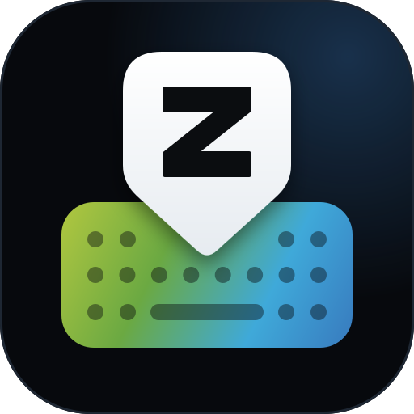

> **zHeal Meridian keyboard:** This fork of zBoard additionally measures typing dynamics (only timings and key types,
> never characters) for the zHeal Meridian app. Details (German) in [Meridian/README.md](Meridian/README.md).



# zBoard

🇬🇧 **English** | 🇩🇪 [Deutsch](README.de.md)

[](https://github.com/World-of-Bytes/zBoard/actions/workflows/build.yml)

zBoard is a free Android keyboard modelled on Gboard in look, feel and features:
word suggestions, autocorrect, glide typing, next-word prediction, phrase suggestions, email suggestions, emoji,
clipboard and voice typing for German, English, French, Spanish and Italian.
Unlike Gboard, zBoard works completely offline and has no internet permission; whatever it learns from your typing
stays on your device. Features that need the internet (such as translating with DeepL) come as separate
plugin apps – only people who install them give them internet access. zBoard is written in C# with .NET 10 for Android.

Status: **all five milestones done** – testing on real devices, not yet published.

## zBoard compared with Gboard

| | Gboard | zBoard |
| --- | --- | --- |
| License | proprietary, source code not public | BSD 2-Clause (code), word lists CC BY-SA 4.0 / CC BY 3.0 |
| Internet access | yes (GIFs, translation, sync and more) | no internet permission; online features only via separate plugin apps |
| Learning from your typing | yes, models are improved with Google's servers via federated learning | yes, only on the device, can be turned off and deleted |
| Languages | a great many languages and layouts | German (QWERTZ), English, Spanish, Italian (QWERTY), French (AZERTY) |
| Typing, shift, symbols, long press for accented characters | ✓ | ✓ in Gboard's order, most frequent character preselected |
| Word suggestions and autocorrect | ✓ | ✓ 120,000 German, 100,000 English words; neighbouring keys, swapped letters, umlauts |
| Multilingual typing (several dictionaries at once, “DE · EN” on the space bar) | ✓ | ✓ up to three languages, language of the previous word preferred |
| Capitalisation at the start of a sentence | ✓ | ✓ also in apps that don't ask for it |
| Capitalising German nouns | ✓ | ✓ |
| Next-word prediction | ✓ | ✓ bundled word pairs plus your own word sequences |
| Suggesting whole phrases ("freundlichen Grüßen") | ✓ | ✓ from what it has learned |
| Suggestions for a word you tap in the text | ✓ | ✓ tapping replaces the whole word |
| Suggesting email addresses | ✓ | ✓ remembered addresses and common providers after "@" |
| Glide typing | ✓ | ✓ |
| Cursor control via space bar, deleting words by swiping | ✓ | ✓ |
| Key preview, vibration, sound | ✓ | ✓ |
| Themes | ✓ | light, dark, Material You (colours from the wallpaper) |
| Emoji keyboard | ✓ | ✓ with categories, skin tones, "recently used" and search in all five languages |
| Clipboard history | ✓ | ✓ one hour, pinning, sensitive content excluded |
| Backup & restore (settings, learned words, email addresses, pinned clips) | partly: learned words only via sync with the Google account, personal dictionary export; no settings backup | ✓ as a ZIP file you store wherever you like, no account needed |
| GIFs and stickers | ✓ | deliberately not (would need internet access) |
| Voice typing | ✓ | ✓ via the system's speech recognition, offline only by default |
| One-handed mode, height, number row | ✓ | ✓ |
| Translation | ✓ | ✓ via the plugin app "zBoard DeepL" (your own DeepL API key) |
| Sync between devices | learned words via the Google account | ✓ via the plugin app "zBoard Sync": settings, learned words, email addresses via Google Drive, OneDrive, Dropbox or WebDAV (HiDrive, Nextcloud …) |
| Google services | ✓ | not planned |

## Build and install

Requirements: .NET 10 SDK, Android workload, Android SDK (included with Visual Studio 2026 or Rider).

```bash
dotnet workload install android
dotnet build -t:Run -f net10.0-android          # builds and installs on the connected device/emulator
```

Then open the **zBoard** app, tap "Enable" and "Select" on the start page and start typing under
"Try the keyboard". Package name: `de.World_of_Bytes.zBoard`.

The user interface is bilingual: German if the system language is German, English otherwise
(`Localization/L.cs`, texts written directly in the code as `L.T("Deutsch", "English")`).

## Test version and releases

- Every push to `main` builds a debug and a release version (AOT), tests both in the emulator and publishes the
  release version, signed with the public test key, as the
  [test version](https://github.com/World-of-Bytes/zBoard/releases/download/testversion/zboard-test.apk).
- **Store version:** publish a release on GitHub (tag `v<version>`). GitHub Actions then builds
  `zboard-<version>.aab` (for Google Play) and `zboard-<version>.apk` with the upload key from the repository secrets,
  plus the DeepL plugin, and attaches them to the release. Setting up the key: [signing/README.md](signing/README.md).
- Texts, graphics and details for the Play Store listing: [docs/store](docs/store/listing.md),
  privacy policy: [docs/PRIVACY.md](docs/PRIVACY.md).
- Version: `ApplicationDisplayVersion` and `ApplicationVersion` (increase by 1 for every store upload) in `ZBoard.csproj`.

## Tests

The logic that does not depend on Android (dictionary, autocorrect, prediction, phrases, learning, email addresses,
glide typing, emoji, clipboard, layouts, accented-character popup, backups) has its own unit tests:

```bash
dotnet test tests/ZBoard.Core.Tests
```

The emulator test (`tools/emulator_test.py`, run by GitHub Actions) checks typing, autocorrect, glide typing, the
popups, the suggestion bar and the layout on a real Android system, partly by measuring screenshots.

## Structure

| Folder | Contents |
| --- | --- |
| `Ime/` | `ZBoardImeService` (the heart of it), `EditorProfile` (properties of the input field), `TextBoundaries` |
| `Keyboard/` | layout model, all layouts, `KeyboardView` (drawing and touch), `PopupGrid` (popup layout), colours |
| `Emoji/` | `EmojiCatalog` (data, search, skin tones), `EmojiPanelView` |
| `Clipboard/` | `ClipboardHistory`, `ClipboardPanelView` |
| `Suggestions/` | `WordDictionary` (sorted array), `SuggestionEngine`, `GlideDecoder`, `BigramModel`, `UserHistory`, `EmailMemory`, `KeyProximity`, `SuggestionBarView` |
| `Settings/` | `SettingsActivity` (start screen), `ZBoardSettings` |
| `Backup/` | `BackupArchive` (backup file: writing, reading, validation) |
| `Assets/dict/` | word lists and word pairs per language |
| `Assets/emoji/` | emoji by category, names and search terms per language |
| `Plugins/` | `PluginContract` (interface), `PluginRegistry` (installed plugins), `PluginClient` (messenger) |
| `plugin-apps/DeepL/` | plugin app "zBoard DeepL" (a separate app with internet permission) |
| `Sync/` | `SyncManager` (sync through a plugin), `SyncFileProvider` (hands the file to the plugin) |
| `plugin-apps/Sync/` | plugin app "zBoard Sync" (Google Drive, OneDrive, Dropbox, WebDAV); provider setup in its README |
| `tools/` | `build_dictionaries.py` (word lists), `build_emoji.py` (emoji data), `emulator_test.py` |
| `tests/` | unit tests for the platform-independent logic |

## Dictionaries

Bundled: **German** with 120,000 words and **English** with 100,000 words, each ranked by frequency in film and TV
subtitles (OpenSubtitles 2018). Format: one spelling per line, `word<TAB>frequency`.
The script filters out typical typos from the subtitles ("nciht", "waht").

For prediction: the 5,000 most frequent word pairs each (`de.bigrams.txt`, `en.bigrams.txt`) from the Google Books
Ngram Corpus, format `first<TAB>second<TAB>frequency`. zBoard learns the rest from your typing
(`files/learning/<language>.tsv` in the app's private storage).

Capitalisation in German:

- Pure nouns appear in the list only capitalised. zBoard automatically writes "haus" as "Haus" when you press space
  (deleting right afterwards undoes it).
- Ambiguous words ("frage/Frage", "essen/Essen") appear in both spellings. zBoard keeps what you typed and offers the
  other form in the suggestion bar.

### Regenerating the dictionaries

```bash
git clone --depth 1 --filter=blob:none --sparse https://github.com/hermitdave/FrequencyWords
git -C FrequencyWords sparse-checkout set --no-cone /content/2018/de/de_full.txt /content/2018/en/en_full.txt
git clone --depth 1 https://github.com/gambolputty/german-nouns
git clone --depth 1 --filter=blob:none --sparse https://github.com/wooorm/dictionaries
git -C dictionaries sparse-checkout set --no-cone /dictionaries/de/index.dic

python3 tools/build_dictionaries.py \
  --freq-de FrequencyWords/content/2018/de/de_full.txt \
  --freq-en FrequencyWords/content/2018/en/en_full.txt \
  --nouns german-nouns/german_nouns/nouns.csv \
  --hunspell-de dictionaries/dictionaries/de/index.dic \
  --bigrams-de google-books-ngram-frequency/ngrams/2grams_german.csv \
  --bigrams-en google-books-ngram-frequency/ngrams/2grams_english.csv
```

The word pairs come from `git clone --depth 1 https://github.com/orgtre/google-books-ngram-frequency`.

Capitalisation errors can be corrected with the hand-maintained lists at the top of the script
(`DE_FORCE_LOWER`, `DE_FORCE_NOUN`, `DE_FORCE_BOTH`).

## License

The code is licensed under the **BSD 2-Clause License** (`LICENSE`). The word lists in `Assets/dict/` are licensed
under **CC BY-SA 4.0**, the word pairs under **CC BY 3.0**; sources and obligations in `THIRD_PARTY_NOTICES.md`.
The app credits the sources under "About zBoard".

## Glide typing

`GlideDecoder` compares the swiped path with the ideal path of every word whose first and last letters lie close to
the start and end of the path: both lines are resampled to 40 evenly spaced points, and the mean deviation – together
with word frequency, sentence context and learned words – determines the ranking.

The parameters were tuned with simulated swipe paths on the German dictionary
(100 words each, hit at rank 1 / within the top 3):

| Words | clean path | sloppy path |
| --- | --- | --- |
| frequent (top 400) | 99 % / 100 % | 84 % / 99 % |
| medium (rank 400–5,000) | 94 % / 100 % | 79 % / 95 % |
| rare (rank 5,000–30,000) | 78 % / 98 % | 68 % / 92 % |

"Sloppy" means: start and end up to half a key off, corners with deviation. Many of the remaining mix-ups are genuine
ambiguities ("bist/biest", "fast/fest") that Gboard, too, only resolves via the suggestion bar. Real swipe paths on a
device will shift these numbers.

## Deliberate differences from Gboard

Features and handling are modelled on Gboard. Google's name, logo, icons, colours, code and dictionary data are not
used. zBoard has no internet permission (release build).

## Emoji, clipboard, plugins and other features

- **Emoji:** the ☺ key left of the comma. Categories at the bottom, 🕘 recently used, 🔍 search. While searching, the
  keyboard types into the search field in the bar ("thumbs", "good", "laugh"); matches appear next to it. Long-pressing
  people emoji shows the skin tones. Emoji the device's font does not know are hidden.
- **Toolbar:** appears when there is nothing to suggest: 📋 clipboard, 🎤 voice typing,
  ✋ one-handed mode (right → left → off), ⚙ settings. Text you have just copied appears there as a suggestion for
  90 seconds.
- **Accented characters:** long-press a letter. As in Gboard, the characters appear in a grid above your finger,
  with the most frequent one (ö on o, ä on a, é on e in French …) preselected.
- **Plugins:** online features as separate apps, e.g. **zBoard DeepL** for translating (`plugin-apps/DeepL`).
  zBoard itself stays offline; turn plugins on under Settings → Plugins and use them via the puzzle icon in the bar.
  Interface for your own plugins: [docs/PLUGINS.md](docs/PLUGINS.md).
- **Phrases:** what you write repeatedly in the same order ("freundlichen Grüßen") is suggested as a whole on the right
  of the bar – while typing the first word and after the space. Only from what it has learned.
- **Tapping a word:** if you tap a word in the text, the bar shows suggestions and corrections for it again;
  tapping one replaces the whole word.
- **Email addresses:** in email fields the bar suggests remembered addresses – even in an empty field and matching what
  you have started, and after "@" also common providers (gmail.com, web.de, gmx.de …). zBoard remembers what is in the
  field as a valid address when you leave it or press Enter (not in incognito mode). Long-pressing an address in the
  bar removes it; delete all of them under Settings → Dictionary. Many apps don't mark their email field (only a
  “Email address” label above it): in single-line form fields zBoard therefore also suggests remembered addresses as soon
  as the field holds a single word of at least three letters that starts one of them, and remembers an address when the
  field ends up containing exactly one valid address.
- **Clipboard:** history of the last hour, pinning (📌) keeps items permanently. Only pinned items are saved;
  content marked as sensitive (e.g. from password managers) and copies from password fields are never taken.
- **Backup & restore:** Settings → Backup & restore saves your settings, learned words and phrases, remembered email
  addresses and pinned clipboard items (each optional) to a ZIP file; the system file picker decides where it goes
  (Downloads, a cloud storage app …). Restoring shows what the backup contains and replaces exactly those parts – on
  the same or a new device. The file is not encrypted; zBoard itself still needs no internet permission.
- **Sync:** with the plugin app **zBoard Sync** (`plugin-apps/Sync`) zBoard keeps settings, learned words and email
  addresses in sync between devices – via Google Drive, OneDrive, Dropbox or WebDAV (HiDrive, Nextcloud …). Turn it on
  under Settings → Backup & restore. Learned data is united, for settings the most recently changed side wins;
  device-specific things (current language, emoji history, clipboard, plugins) stay on the device. Syncing happens when
  the keyboard opens and closes, at most every 15 minutes.
- **Multilingual typing:** Like Gboard, zBoard uses the dictionaries of all active languages at once (up to three); the
  space bar then shows e.g. “DE · EN”. An English word in a German sentence is not “corrected”, typos are corrected into
  the matching language, and what you write is learned in the language the word belongs to. If the previous word clearly
  belongs to one language, its suggestions come first. Switching languages (long-press the space bar) then only picks the
  layout. Can be turned off under Settings → Languages. To make languages comparable, zBoard scales the frequencies of all
  word lists to the same total (`WordDictionary.ReferenceTotal`); rare entries of another language (typos from the
  subtitles such as “teh”) don't prevent a correction.
- **Voice typing:** uses the system's speech recognition. By default only if the device can recognise speech offline
  (Android 12 and later, depending on the manufacturer); otherwise your speech would go to the provider of the
  recognition service. The zBoard app asks for the microphone permission the first time you tap 🎤.

### Regenerating the emoji data

```bash
git clone --depth 1 https://github.com/muan/unicode-emoji-json
git clone --depth 1 --filter=blob:none --sparse https://github.com/unicode-org/cldr
git -C cldr sparse-checkout set --no-cone /common/annotations /common/annotationsDerived
python3 tools/build_emoji.py --emoji-json unicode-emoji-json/data-by-group.json --cldr cldr
```

The logo and the app icon (World of Bytes colours) are generated by `python3 tools/build_logo.py`.

More dictionary languages: `--extra fr:fr_full.txt:2grams_french.csv` (see `tools/build_dictionaries.py --help`).

## Next steps

- Testing on real devices: typing feel, glide recognition with real paths, loading time and memory of the
  dictionaries, voice typing on devices with and without offline recognition
- F-Droid metadata
- More user-interface languages (French, Spanish, Italian)
