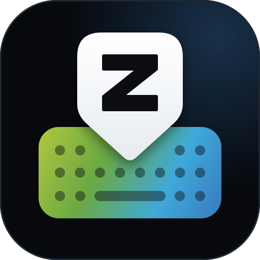

> **zHealth Meridian keyboard:** This fork of zBoard additionally measures typing dynamics (only timings and key types,
> never characters) for the zHealth Meridian app. Details (German) in [Meridian/README.md](Meridian/README.md).



# zBoard

🇬🇧 **English** | 🇩🇪 [Deutsch](README.de.md)

[](https://github.com/World-of-Bytes/zBoard/actions/workflows/build.yml)

zBoard is a free Android keyboard modelled on Gboard in look, feel and features:
word suggestions and autocorrect that take the sentence into account, glide typing, next-word prediction, phrase
suggestions, email suggestions, emoji, clipboard and voice typing in 18 languages – from German and English to Russian,
Greek, Arabic and Chinese (Pinyin).
Unlike Gboard, zBoard works completely offline and has no internet permission; whatever it learns from your typing
stays on your device. Features that need the internet (such as translating with DeepL) come as separate
plugin apps – only people who install them give them internet access. zBoard is written in C# with .NET 10 for Android.

Status: **version 1.0.0**, all five milestones done – testing on real devices. The 13 languages added in 0.13.0 are
covered by unit tests but have not been tried on a real device yet.
Finished versions: [Releases](https://github.com/World-of-Bytes/zBoard/releases).

## zBoard compared with Gboard

| | Gboard | zBoard |
| --- | --- | --- |
| License | proprietary, source code not public | BSD 2-Clause (code), word lists and language models CC BY-SA 4.0 |
| Internet access | yes (GIFs, translation, sync and more) | no internet permission; online features only via separate plugin apps |
| Learning from your typing | yes, models are improved with Google's servers via federated learning | yes, only on the device, can be turned off and deleted; what you stop using loses weight over time |
| Languages | a great many languages and layouts | 18 languages: German, Czech, Hungarian (QWERTZ); English, Spanish, Italian, Dutch, Polish, Romanian, Turkish, Vietnamese (QWERTY); French (AZERTY); Greek; Russian, Ukrainian, Bulgarian (Cyrillic); Arabic; Chinese (Pinyin, simplified characters) |
| Typing, shift, symbols, long press for accented characters | ✓ | ✓ in Gboard's order, most frequent character preselected |
| Word suggestions and autocorrect | ✓ | ✓ 120,000 German, 100,000 English words, up to 80,000 for each further language; uses where the finger hit each key; swapped letters, left-out umlauts and apostrophes |
| Language model | neural network, sees the whole sentence | count table of frequent word sequences (two words before) plus a small on-device neural network that sees the whole sentence (can be turned off); each up to about 2.5 MB per language |
| Correction that follows the sentence | ✓ | ✓ "ich hae" → "habe"; correctly spelled words only when the finger was almost on the key border ("heute drei" → "frei") |
| Missing and accidental spaces | ✓ | ✓ "ihave" → "I have", "da ke" → "danke" |
| German compound nouns | ✓ | ✓ recognised from known nouns, capitalised and completed ("Haustürschlüssel") |
| Multilingual typing (several dictionaries at once, “DE · EN” on the space bar) | ✓ | ✓ up to three languages, language of the previous word preferred |
| Capitalisation at the start of a sentence | ✓ | ✓ also in apps that don't ask for it |
| Capitalising German nouns | ✓ | ✓ ambiguous words from the sentence ("eine frage" → "Frage") |
| Next-word prediction | ✓ | ✓ from the language model and your own word sequences, also at sentence start and after a comma |
| Suggesting whole phrases ("freundlichen Grüßen") | ✓ | ✓ from what it has learned |
| Suggestions for a word you tap in the text | ✓ | ✓ tapping replaces the whole word |
| Suggesting email addresses | ✓ | ✓ remembered addresses and common providers after "@" |
| Personal dictionary with shortcuts ("brb" → "be right back") | ✓ | ✓ own words and shortcuts for all languages, included in backup and sync |
| Glide typing | ✓ | ✓ |
| Chinese with Pinyin | ✓ | ✓ simplified characters, scrolling candidate row, learns the characters you choose |
| Vietnamese with Telex | ✓ | ✓ can be turned off |
| Cursor control via space bar, deleting words by swiping | ✓ | ✓ |
| Text editing (arrow keys, select, copy, cut, paste) | ✓ | ✓ from the toolbar |
| Key preview, vibration, sound | ✓ | ✓ |
| Themes | ✓ | light, dark, Material You (colours from the wallpaper), your own image (can be darkened), key borders on/off |
| Emoji keyboard | ✓ | ✓ with categories, skin tones, "recently used" and search in all 18 languages |
| Clipboard history | ✓ | ✓ one hour, pinning, sensitive content excluded |
| Backup & restore (settings, learned words, email addresses, pinned clips) | partly: learned words only via sync with the Google account, personal dictionary export; no settings backup | ✓ as a ZIP file you store wherever you like, no account needed |
| GIFs and stickers | ✓ | deliberately not (would need internet access) |
| Voice typing | ✓ | ✓ via the system's speech recognition, offline only by default |
| Toolbar (clipboard, microphone, settings) | ✓ | ✓ via the arrow at the left of the suggestion bar |
| One-handed mode, height, number row | ✓ | ✓ |
| Floating keyboard | ✓ | ✓ from the toolbar, movable by its handle |
| Split keyboard (tablets, foldables) | ✓ | ✓ on screens from 600 dp wide, in landscape by default |
| Translation | ✓ | ✓ via the plugin app "zBoard DeepL" (your own DeepL API key) |
| Handwriting | ✓ | ✓ via the plugin app "zBoard Pen" (Google ML Kit, recognition on the device) |
| Sync between devices | learned words via the Google account | ✓ via the plugin app "zBoard Sync": settings, learned words, email addresses via Google Drive, OneDrive, Dropbox or WebDAV (HiDrive, Nextcloud …) |
| Google services | ✓ | not planned |

## Build and install

Requirements: .NET 10 SDK, Android workload, Android SDK (included with Visual Studio 2026 or Rider).

```bash
dotnet workload install android
dotnet build -t:Run -f net10.0-android          # builds and installs on the connected device/emulator
```

Then open the **zBoard** app, tap "Enable" and "Select" on the start page and start typing under
"Try the keyboard". Package name: `de.World_of_Bytes.zBoard`.

The user interface is bilingual: German if the system language is German, English otherwise
(`Localization/L.cs`, texts written directly in the code as `L.T("Deutsch", "English")`).

## Test version and releases

- Every push to `main` builds a debug and a release version (AOT), tests both in the emulator and publishes the
  release version, signed with the public test key, as the
  [test version](https://github.com/World-of-Bytes/zBoard/releases/download/testversion/zboard-test.apk).
- **Store version:** publish a release on GitHub (tag `v<version>`). GitHub Actions then builds
  `zboard-<version>.aab` (for Google Play) and `zboard-<version>.apk` with the upload key from the repository secrets,
  plus the DeepL plugin, and attaches them to the release. Setting up the key: [signing/README.md](signing/README.md).
- Texts, graphics and details for the Play Store listing: [docs/store](docs/store/listing.md),
  privacy policy: [docs/PRIVACY.md](docs/PRIVACY.md).
- Version: `ApplicationDisplayVersion` and `ApplicationVersion` (increase by 1 for every store upload) in `ZBoard.csproj`.

## Tests

The logic that does not depend on Android (dictionary, autocorrect, language model, finger positions, compound
words, spaces, prediction, phrases, learning, email addresses, personal dictionary, glide typing, emoji, clipboard, layouts,
accented-character popup, backups, all 18 languages, Pinyin, Telex) has its own unit tests:

```bash
dotnet test tests/ZBoard.Core.Tests
```

The emulator test (`tools/emulator_test.py`, run by GitHub Actions) checks typing, autocorrect, missing and
accidental spaces, glide typing, the popups, the suggestion bar and the layout on a real Android system, partly by
measuring screenshots.

`tools/SuggestionEval` measures the quality of suggestions and autocorrect with simulated typing (the metrics in
detail, in German: [tools/SuggestionEval/README.md](tools/SuggestionEval/README.md); results under
[Suggestions and autocorrect](#suggestions-and-autocorrect)):

```bash
dotnet run -c Release --project tools/SuggestionEval -- --lang de
```

`tools/LoadBench` measures how long word lists and language models take to load (and how much memory), and the
computing time per keystroke while typing. The emulator
test also reloads the keyboard from scratch several times and reports the timings in its summary (service start,
loading per language, time per suggestion):

```bash
dotnet run -c Release --project tools/LoadBench -- de en
```

So that suggestions are back quickly after the keyboard has been reloaded, zBoard stores each word list in a
prepared form in the app's cache after loading it for the first time (`cache/dict/`; rebuilt after an update).

## Structure

| Folder | Contents |
| --- | --- |
| `Ime/` | `ZBoardImeService` (the heart of it), `EditorProfile` (properties of the input field), `TextBoundaries` |
| `Keyboard/` | `HandwritingPanelView` (writing area), `TextEditPanelView` (text editing), layout model, all layouts, `KeyboardView` (drawing and touch), `PopupGrid` (popup layout), colours |
| `Emoji/` | `EmojiCatalog` (data, search, skin tones), `EmojiPanelView` |
| `Clipboard/` | `ClipboardHistory`, `ClipboardPanelView` |
| `Suggestions/` | `WordDictionary` (sorted array), `SuggestionEngine`, `GlideDecoder`, `NgramModel` (language model), `NeuralModel` and `OnnxLanguageModel` (AI prediction), `TouchTrace` (finger positions), `UserHistory`, `EmailMemory`, `PersonalDictionary` (own words and shortcuts), `KeyProximity`, `TextCase` (upper and lower case per language), `PinyinEngine` and `PinyinLearned` (Chinese), `Telex` (Vietnamese), `CandidateStrip` (layout of the candidate row), `SuggestionBarView` |
| `Settings/` | `SettingsActivity` (start screen), `ZBoardSettings` |
| `Backup/` | `BackupArchive` (backup file: writing, reading, validation) |
| `Assets/dict/` | word lists and language models per language |
| `Assets/lm/` | neural language models (`<language>.lm.onnx`, `<language>.vocab.txt`) |
| `Assets/emoji/` | emoji by category, names and search terms per language |
| `Plugins/` | `PluginContract` (interface), `PluginRegistry` (installed plugins), `PluginClient` (messenger) |
| `plugin-apps/DeepL/` | plugin app "zBoard DeepL" (a separate app with internet permission) |
| `plugin-apps/Pen/` | plugin app "zBoard Pen" (handwriting with Google ML Kit) |
| `Sync/` | `SyncManager` (sync through a plugin), `SyncFileProvider` (hands the file to the plugin) |
| `plugin-apps/Sync/` | plugin app "zBoard Sync" (Google Drive, OneDrive, Dropbox, WebDAV); provider setup in its README |
| `tools/` | `build_dictionaries.py` (word lists), `NgramBuilder` (language models), `LanguageModel/train_lm.py` (AI prediction), `SuggestionEval` (suggestion measurement), `LoadBench` (loading times, time per keystroke), `build_emoji.py` (emoji data), `emulator_test.py` |
| `tests/` | unit tests for the platform-independent logic |

## Dictionaries

Bundled: **German** with 120,000 words and **English** with 100,000 words, each ranked by frequency in film and TV
subtitles (OpenSubtitles 2018). Format: one spelling per line, `word<TAB>frequency`.
The script filters out typical typos from the subtitles ("nciht", "waht").
The source splits English contractions ("don't", "I'm") into two entries; the script puts them back together
(frequencies partly estimated, see `EN_SUFFIX_SHARES`).

The other languages come from the same source, up to 80,000 words each: French, Spanish, Italian, Dutch, Polish,
Czech, Hungarian, Romanian, Turkish, Greek, Russian, Ukrainian, Bulgarian and Arabic; Vietnamese has 37,000 (almost
every syllable is a word there). The script keeps only words in the language's script and drops entries without
accents when the same letters with accents are clearly more frequent – many subtitles are typed without them
("dziekuje"). Chinese: 65,000 words in simplified characters (`zh.txt`) and the Pinyin table `zh.pinyin.txt` with
the spelling of every word and all readings of the 8,105 commonly used characters.

For prediction: one language model per language (`de.ngrams.bin` …) with the 200,000 most frequent two-word and
150,000 most frequent three-word sequences, counted in the public-domain sentence collection of Mozilla Common Voice.
It drives next-word prediction, the order of suggestions, the choice of correction and the capitalisation of
ambiguous German words ("eine frage" → "Frage"). zBoard learns the rest from your typing
(`files/learning/<language>.tsv` in the app's private storage). The models are only as good as their source is large:
about 2.4 MB for most languages, but only 1.3 MB for Arabic, 0.7 MB for Romanian and under 0.4 MB for Greek and
Vietnamese – there are only a few thousand sentences for those so far, and prediction is correspondingly thin.

Capitalisation in German:

- Pure nouns appear in the list only capitalised. zBoard automatically writes "haus" as "Haus" when you press space
  (deleting right afterwards undoes it).
- Ambiguous words ("frage/Frage", "essen/Essen") appear in both spellings. zBoard capitalises them where the
  language model clearly expects the noun ("eine frage" → "Frage", "vielen dank" → "Dank"); otherwise it keeps what
  you typed and offers the other form in the suggestion bar.
- Compound nouns that are not in the list themselves are recognised from their parts ("Haus" + "Tür" + "Schlüssel",
  also with a linking "s") and capitalised.

### Regenerating the dictionaries

```bash
git clone --depth 1 --filter=blob:none --sparse https://github.com/hermitdave/FrequencyWords
git -C FrequencyWords sparse-checkout set --no-cone /content/2018/de/de_full.txt /content/2018/en/en_full.txt
git clone --depth 1 https://github.com/gambolputty/german-nouns
git clone --depth 1 --filter=blob:none --sparse https://github.com/wooorm/dictionaries
git -C dictionaries sparse-checkout set --no-cone /dictionaries/de/index.dic

python3 tools/build_dictionaries.py \
  --freq-de FrequencyWords/content/2018/de/de_full.txt \
  --freq-en FrequencyWords/content/2018/en/en_full.txt \
  --nouns german-nouns/german_nouns/nouns.csv \
  --hunspell-de dictionaries/dictionaries/de/index.dic
```

Capitalisation errors can be corrected with the hand-maintained lists at the top of the script
(`DE_FORCE_LOWER`, `DE_FORCE_NOUN`, `DE_FORCE_BOTH`).

### Regenerating the language models

```bash
git clone --depth 1 --filter=blob:none --sparse https://github.com/common-voice/common-voice
git -C common-voice sparse-checkout set --no-cone '/server/data/de/*' '/server/data/en/*'

dotnet run -c Release --project tools/NgramBuilder -- \
  --words Assets/dict/de.txt --out Assets/dict/de.ngrams.bin --common-voice common-voice/server/data/de
```

Likewise for the other languages (`en`, `fr`, `es`, `it`, `nl`, `pl`, `cs`, `hu`, `ro`, `tr`, `vi`, `el`, `ru`, `uk`,
`bg`, `ar`; for Chinese see below). Submitted everyday sentences count ten times, Wikipedia
sentences only 15 %, because they read differently from messages; add your own texts with `--source`.
Regenerate the models after changing the word lists so the spellings match.

## License

The code is licensed under the **BSD 2-Clause License** (`LICENSE`). The word lists and language models in
`Assets/dict/` are licensed under **CC BY-SA 4.0**; sources and obligations in `THIRD_PARTY_NOTICES.md`.
The app credits the sources under "About zBoard".

## Suggestions and autocorrect

Suggestions and corrections come from six sources. All of them live on the device:

- **Dictionary** (`WordDictionary`): how frequent a word is.
- **Language model** (`NgramModel`): a count table of which word follows the one or two words before it, and how
  often. It drives next-word prediction ("Vielen" → "Dank"), also at the start of a sentence and after a comma, the
  order of suggestions, the choice of correction ("ich hae" → "habe", not the more frequent "hat") and the
  capitalisation of ambiguous words. Every value is a count you can trace; the model sees no further back than two
  words.
- **AI prediction** (`NeuralLanguageModel`, `Assets/lm/`): a small LSTM network per language (about 2.5 MB, int8, run
  with ONNX Runtime) that sees the whole sentence up to the cursor. It is mixed with the count model for prediction,
  the order of suggestions, the choice of correction and glide typing. It never decides whether a correctly spelled
  word gets corrected. Runs offline, learns nothing from your typing and can be turned off under Settings →
  Suggestions → "AI prediction". Training and measuring: [tools/LanguageModel](tools/LanguageModel/README.md)
  (German).
- **Finger position** (`TouchTrace`): the keyboard remembers where the finger hit the key for every letter. A hit
  on the border between "g" and "h" leaves both letters almost equally likely; a hit in the middle of "g" speaks
  against "h".
- **Rules for typical mistakes**: left-out umlauts and apostrophes ("fur" → "für", "dont" → "don't"), swapped
  letters, a missing space ("ihave" → "I have"), the space bar hit in the middle of a word ("da ke" → "danke"), and
  German compound nouns, which count as correct and are completed.
- **What it has learned** (`UserHistory`): your own words and word sequences take precedence. A word you have
  typed several times, or restored after a correction, is no longer corrected. After every 5,000 learned words the counts are halved, so that what you write today
  counts most; known words stay known.

A word that is in the dictionary normally stays as typed. It is corrected in three cases only:

1. It is the lazy spelling of a much more frequent word ("fur", "mussen", "dont").
2. It is a very rare entry right next to a very frequent word ("yiu" next to "you"). The word lists come from
   subtitles and contain such typos.
3. The finger was almost on the border to the neighbouring key, and the word with the neighbouring letter fits the
   sentence much better ("heute drei" → "frei").

Deleting right after a correction restores what you typed, and zBoard remembers it.

### Measured

`tools/SuggestionEval` types about 1,000 words of everyday text per language, once without mistakes and five times
with simulated typos:

| | German 0.11.1 | German 0.12.0 | English 0.11.1 | English 0.12.0 |
| --- | --- | --- | --- | --- |
| Next word among the top 3 suggestions (after a word) | 15.6 % | 28.2 % | 18.2 % | 33.6 % |
| Word in the bar after half its letters | 61.1 % | 76.6 % | 71.0 % | 83.7 % |
| Keystrokes saved | 42.1 % | 51.0 % | 39.3 % | 49.9 % |
| Typos corrected | 66.3 % | 81.9 % | 60.1 % | 78.9 % |
| Correctly typed words that were changed | 0.0 % | 0.0 % | 1.4 % | 0.0 % |
| Wrong words in the text after correction | 8.8 % | 4.8 % | 8.5 % | 4.3 % |
| Missing space: split correctly | – | 68.6 % | – | 63.5 % |
| Space bar instead of a letter: word restored | – | 57.4 % | – | 68.3 % |

These numbers come from the simulation, not from real fingers. That applies most to the gain from finger positions:
the correction assumes the same kind of scatter the measurement types with. All other languages have
language models from the same process but no test sentences yet – there is no measurement for them. In places the language models sound like Wikipedia
and parliament, because the source contains little everyday text.

## Glide typing

`GlideDecoder` compares the swiped path with the ideal path of every word whose first and last letters lie close to
the start and end of the path: both lines are resampled to 40 evenly spaced points, and the mean deviation – together
with word frequency, sentence context and learned words – determines the ranking.

The parameters were tuned with simulated swipe paths on the German dictionary
(100 words each, hit at rank 1 / within the top 3):

| Words | clean path | sloppy path |
| --- | --- | --- |
| frequent (top 400) | 99 % / 100 % | 84 % / 99 % |
| medium (rank 400–5,000) | 94 % / 100 % | 79 % / 95 % |
| rare (rank 5,000–30,000) | 78 % / 98 % | 68 % / 92 % |

"Sloppy" means: start and end up to half a key off, corners with deviation. Many of the remaining mix-ups are genuine
ambiguities ("bist/biest", "fast/fest") that Gboard, too, only resolves via the suggestion bar. Real swipe paths on a
device will shift these numbers.

## Deliberate differences from Gboard

Features and handling are modelled on Gboard. Google's name, logo, icons, colours, code and dictionary data are not
used. zBoard has no internet permission (release build).

## Emoji, clipboard, plugins and other features

- **Emoji:** the ☺ key left of the comma. Categories at the bottom, 🕘 recently used, 🔍 search. While searching, the
  keyboard types into the search field in the bar ("thumbs", "good", "laugh"); matches appear next to it. Long-pressing
  people emoji shows the skin tones. Emoji the device's font does not know are hidden.
- **Toolbar:** 📋 clipboard, text editing, 🎤 voice typing, ✋ one-handed mode (right → left → off), ⚙ settings. It appears in an
  empty field and when there is nothing to suggest; otherwise the arrow at the left of the suggestion bar opens it,
  and the arrow there, or simply typing on, brings the suggestions back. Text you have just copied appears there as
  a suggestion for 90 seconds.
- **Themes:** besides light, dark and Material You there is "My image": the chosen picture sits behind the bar and the
  keys, a slider darkens it, and the labels turn light or dark to match. "Key borders" off draws only the labels (as
  in Gboard). The image stays on the device and is not part of backup and sync.
- **Floating keyboard:** the four-way arrow in the toolbar makes the keyboard narrower and freely movable (handle
  below the keys); the app underneath is not resized. Tap it again to dock the keyboard at the bottom.
- **Split keyboard:** on screens at least 600 dp wide (tablets, unfolded foldables) the two halves of the keys move to
  the edges, with a space bar on each side. Settings → Preferences → Layout: off, in landscape (default) or always.
- **Text editing:** the cursor icon in the toolbar replaces the keys with arrow keys (including start and end of
  line). "Select" makes the arrows select text; next to them are Select all, Copy, Cut and Paste. Arrows and delete
  repeat while held, "ABC" returns to the keys.
- **Accented characters:** long-press a letter. As in Gboard, the characters appear in a grid above your finger,
  with the most frequent one (ö on o, ä on a, é on e in French …) preselected.
- **Handwriting:** with the plugin app **zBoard Pen** a pen appears in the toolbar. It opens a writing area; the
  recognized word appears underlined in the field, alternatives in the bar. After a short pause the next word begins,
  delete discards the word you just wrote, "ABC" returns to the keyboard. Recognition runs on the device with Google
  ML Kit; zBoard Pen only needs the internet for the handwriting models (about 20 MB per language).
- **Plugins:** online features as separate apps, e.g. **zBoard DeepL** for translating (`plugin-apps/DeepL`).
  zBoard itself stays offline; turn plugins on under Settings → Plugins and use them via the puzzle icon in the bar.
  Interface for your own plugins: [docs/PLUGINS.md](docs/PLUGINS.md).
- **Phrases:** what you write repeatedly in the same order ("freundlichen Grüßen") is suggested as a whole on the right
  of the bar – while typing the first word and after the space. Only from what it has learned.
- **Tapping a word:** if you tap a word in the text, the bar shows suggestions and corrections for it again;
  tapping one replaces the whole word.
- **Email addresses:** in email fields the bar suggests remembered addresses – even in an empty field and matching what
  you have started, and after "@" also common providers (gmail.com, web.de, gmx.de …). zBoard remembers what is in the
  field as a valid address when you leave it or press Enter (not in incognito mode). Long-pressing an address in the
  bar removes it; delete all of them under Settings → Dictionary. Many apps don't mark their email field (only a
  “Email address” label above it): in single-line form fields zBoard therefore also suggests remembered addresses as soon
  as the field holds a single word of at least three letters that starts one of them, and remembers an address when the
  field ends up containing exactly one valid address.
- **Personal dictionary:** under Settings → Dictionary → Personal dictionary you add your own words and shortcuts.
  The bar suggests your own words (names, technical terms, “zBoard”) as you type; autocorrect leaves them alone and
  applies the stored spelling (“zboard” → “zBoard”). When you type a shortcut (“brb”), the bar shows its text (“be
  right back”); as in Gboard it is only inserted when you tap it. Entries apply to all languages and are part of the
  settings – backup and sync include them.
- **Formal address (German):** once the field contains "Sehr geehrte …" or a capitalised "Sie", "Ihnen", "Ihre" in
  mid-sentence, zBoard capitalises these words from then on ("erhalten sie" → "Sie"; deleting right after undoes it).
  Otherwise the capitalised form is offered in the bar.
- **Personal touch pattern:** zBoard learns how far your finger lands from each key's centre on average (many people
  tap slightly low) and reads touches accordingly, both for the key that was hit and for autocorrect. Only an offset
  per key is stored, no text; separately for portrait and landscape, deleted together with what was learned.
- **Similar words:** if a similar word fits the sentence better than the correctly spelled one ("ich bin in Urlaub" →
  "im"), it appears on the left of the bar; nothing is corrected.
- **Clipboard:** history of the last hour, pinning (📌) keeps items permanently. Only pinned items are saved;
  content marked as sensitive (e.g. from password managers) and copies from password fields are never taken.
- **Backup & restore:** Settings → Backup & restore saves your settings, learned words and phrases, remembered email
  addresses and pinned clipboard items (each optional) to a ZIP file; the system file picker decides where it goes
  (Downloads, a cloud storage app …). Restoring shows what the backup contains and replaces exactly those parts – on
  the same or a new device. The file is not encrypted; zBoard itself still needs no internet permission.
- **Sync:** with the plugin app **zBoard Sync** (`plugin-apps/Sync`) zBoard keeps settings, learned words and email
  addresses in sync between devices – via Google Drive, OneDrive, Dropbox or WebDAV (HiDrive, Nextcloud …). Turn it on
  under Settings → Backup & restore. Learned data is united, for settings the most recently changed side wins;
  device-specific things (current language, emoji history, clipboard, plugins) stay on the device. Syncing happens when
  the keyboard opens and closes, at most every 15 minutes.
- **Languages:** each of the 18 languages comes with its layout, a word list, a language model for prediction and
  emoji search. Turkish capitalizes i/İ and ı/I correctly; Arabic has no shift key and its own punctuation (، ؟);
  typing without accents suggests or inserts the right spelling in every language ("dziekuje" → "dziękuję",
  "ευχαριστω" → "ευχαριστώ", "khong" → "không").
- **Vietnamese (Telex):** as in Gboard, marks and tones are typed with letters: aa → â, aw → ă, ee → ê, oo → ô,
  ow → ơ, uw → ư, dd → đ; s, f, r, x, j set the tone ("tieengs" → "tiếng", "dduowcj" → "được"), z removes it. The
  tone lands on the right vowel by itself ("toans" → "toán", "hoaf" → "hòa"). The same key again takes the change
  back ("ass" → "as"); words of several syllables ("online") stay as typed. Can be turned off under
  Settings → Languages; every character is still available by long press.
- **Chinese (Pinyin):** type Pinyin without tone marks on QWERTY (ü as v); what you type is underlined in the text
  and the bar shows the simplified characters – words spelled exactly like that, whole sentences from the longest
  matching words ("womenshipengyou" → 我们是朋友), words you have started and shorter words for the beginning of your
  input. The row scrolls sideways with your finger; space takes the first (bold) candidate, Enter keeps the letters.
  zBoard remembers your choices on the device: a candidate chosen once moves to second place, chosen twice to
  first – whole sentences too. Your choices belong to the learned words: they are part of the backup
  (`learning/zh.pinyin.tsv`) and are merged with those of other devices when syncing. After a word is inserted, zBoard predicts the next one. Emoji search understands Pinyin ("xiaolian" → 😀).
- **Multilingual typing:** Like Gboard, zBoard uses the dictionaries of all active languages at once (up to three); the
  space bar then shows e.g. “DE · EN”. An English word in a German sentence is not “corrected”, typos are corrected into
  the matching language, and what you write is learned in the language the word belongs to. If the previous word clearly
  belongs to one language, its suggestions come first. Switching languages (long-press the space bar) then only picks the
  layout. Can be turned off under Settings → Languages. To make languages comparable, zBoard scales the frequencies of all
  word lists to the same total (`WordDictionary.ReferenceTotal`); rare entries of another language (typos from the
  subtitles such as “teh”) don't prevent a correction.
- **Voice typing:** uses the system's speech recognition. By default only if the device can recognise speech offline
  (Android 12 and later, depending on the manufacturer); otherwise your speech would go to the provider of the
  recognition service. The zBoard app asks for the microphone permission the first time you tap 🎤.

### Regenerating the emoji data

```bash
git clone --depth 1 https://github.com/muan/unicode-emoji-json
git clone --depth 1 --filter=blob:none --sparse https://github.com/unicode-org/cldr
git -C cldr sparse-checkout set --no-cone /common/annotations /common/annotationsDerived
python3 tools/build_emoji.py --emoji-json unicode-emoji-json/data-by-group.json --cldr cldr
```

The logo, the app icon and the icons of the plugin apps (World of Bytes colours) are generated by `python3 tools/build_logo.py`; the Play Store graphics and the PNG versions of the logos (`docs/logo/*.png`) by `node tools/render_store_graphics.js`.

More dictionary languages: `--extra fr:fr_full.txt` (see `tools/build_dictionaries.py --help`); without
`--freq-de`/`--freq-en` only those are built. Chinese including the Pinyin table:

```bash
git clone --depth 1 https://github.com/mozillazg/pinyin-data
git clone --depth 1 https://github.com/mozillazg/phrase-pinyin-data
python3 tools/build_dictionaries.py --freq-zh FrequencyWords/content/2018/zh_cn/zh_cn_full.txt \
  --pinyin-data pinyin-data --phrase-pinyin-data phrase-pinyin-data
```

For the Chinese language model the sentences must be split into words first (one space between words, e.g. with
[jieba](https://github.com/fxsjy/jieba)); pass that file to `tools/NgramBuilder` with `--source`. For
`keywords.zh.txt`, `tools/build_emoji.py --pinyin-data pinyin-data` adds the Pinyin spelling of the keywords.

A new language needs: layout, name, script and locale in `Keyboard/Layouts.cs`, a word list and language model in
`Assets/dict/`, and `Assets/emoji/keywords.<language>.txt`. `LanguagesTests` then checks, among other things, that
the 3000 most frequent words can be typed with the layout.

## Next steps

- Testing on real devices: typing feel, glide recognition with real paths, loading time and memory of the
  dictionaries and language models, voice typing on devices with and without offline recognition
- Checking the autocorrect thresholds against real typing (so far tuned on simulated typing only)
- Test sentences for every language except German and English; more everyday text for the language models (Greek,
  Vietnamese and Romanian have only a few thousand sentences so far)
- Checking the 13 new languages on real devices, especially Arabic (right-to-left) and Chinese
- F-Droid metadata
- More user-interface languages (French, Spanish, Italian)
